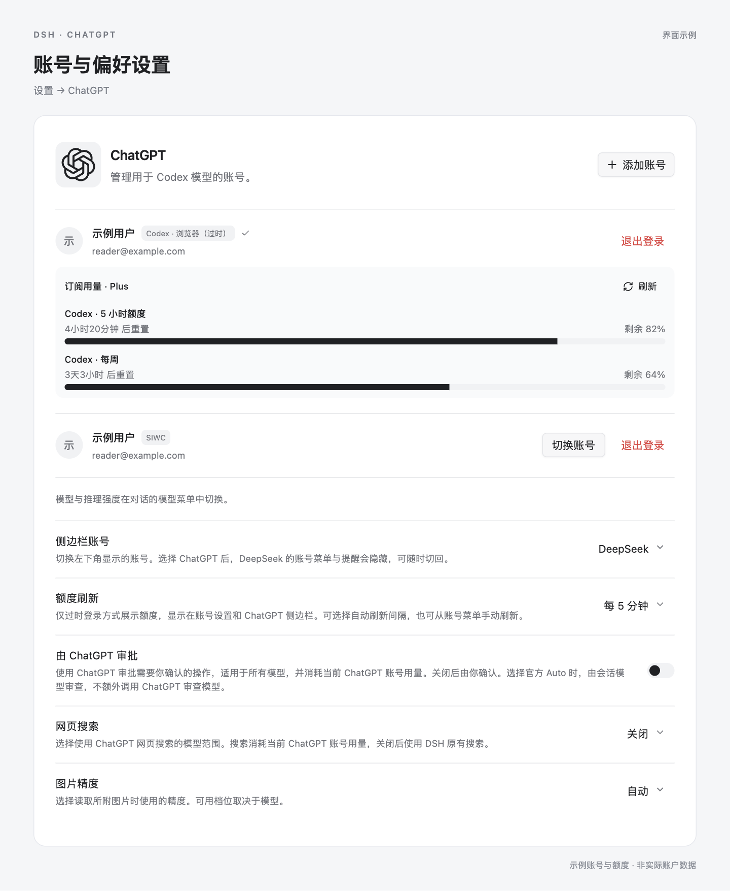

# dsh-chatgpt-rs

为 DeepSeek Harness（DSH）接入 ChatGPT 账号，支持 Codex 模型对话、图片输入、网页搜索与账号管理。

## 安装

Desktop 用户在 **插件 → 添加插件** 中输入 `dsh-chatgpt-rs`，安装并启用。Web profile 用户执行：

```sh
dsh plugin --profile web add dsh-chatgpt-rs
```

安装后，在 Web 界面的插件页启用。自定义 profile 请将 `web` 替换为对应名称。Desktop 与 Web profile 需要分别安装。

适用于 DSH 0.2.2-rc.1，支持 Windows x64、macOS arm64 / x64 和 Linux x64（GNU/glibc）。

## 使用

在 **设置 → ChatGPT** 中登录和管理账号，在对话的模型菜单中选择模型与推理强度。

提供 **继续使用 ChatGPT**（SIWC）、**Codex 浏览器（过时）** 和 **Codex 设备码（过时）** 三种登录方式。

> **OpenAI 建议第三方开源应用使用 [SIWC](https://developers.openai.com/siwc/token-sharing-open-source)**。Codex 过时登录不符合该接入规范，未来可能因 OpenAI 政策或接口调整而受限、失效甚至被判定为违规。SIWC 当前能力相对有限，差异见下表。

| 能力 | SIWC | Codex 浏览器／设备码（过时） |
| --- | --- | --- |
| 模型对话与推理强度选择 | 支持 | 支持 |
| 图片输入 | 支持 | 支持 |
| 网页搜索 | 支持 | 支持 |
| 订阅额度展示与刷新 | 不提供 | 支持 |
| 图片生成 | 不提供 | 支持 |

可用模型、推理档位及图片能力取决于账号和模型。



搜索范围、图片精度、自动审批和侧边栏账号显示均在此设置。搜索与审批也可用于其他模型，消耗当前 ChatGPT 账号用量。切换或退出账号会停止插件正在进行的操作。

## 反馈

请通过 [Issues](https://github.com/noctisynth/dsh-codex-provider/issues) 反馈问题，并附上 DSH 与插件版本、操作系统和错误提示。
